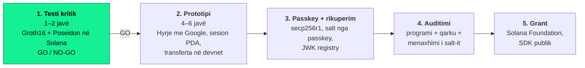

# solanaauth

**Portofol Solana pa frazë sekrete: hyrje me Google/Apple, e verifikuar on-chain me Groth16.**

Çdo aplikacion në Solana të mund t'u japë përdoruesve një portofol vetë-kujdestar me "Hyr me Google/Apple", pa frazë sekrete dhe pa një kompani që mban apo bashkë-mban çelësin. Prova verifikohet nga vetë Solana; passkey-ja është faktori i dytë dhe rruga e rikuperimit. Kodi dhe matjet janë publike që nga dita e parë.

[](https://github.com/intopic/solanaauth/actions/workflows/ci.yml)
· Licenca: [Apache-2.0](LICENSE)

## Harta e projektit



Faza 1 (tani) është vetëm një test matjesh: a pranon Solana provën zkLogin dhe sa compute units (CU) kushton. Rezultati vendos nëse vazhdojnë fazat e tjera.

**Brief-i i plotë për developer-in:** [`docs/HAPI-1-BRIEF.md`](docs/HAPI-1-BRIEF.md)

## Rezultatet e fundit (nga GitHub Actions)

Tabela përditësohet automatikisht nga CI në çdo push në `main`. Pranojmë vetëm numrat e prodhuar këtu, jo matje nga kompjuteri personal.

<!-- CU-RESULTS:START -->
## Matjet e CU — zklogin-verifier

**Vendimi:** GO — `verify_full` (JWT e vërtetë Google, key mainnet, qarku v1) = **110,428 CU** nga limiti 1,400,000 CU i transaksionit.

### `google-mainnet-v1`

JWT e vërtetë nga Google (accounts.google.com), provë e verifikuar me verifying key-n MAINNET të ceremonisë (qarku v1). Burimi: sui-crypto verify.rs::test_verify_zklogin_google.

| Matja | CU | Tx (bytes) | Shënim |
|---|---:|---:|---|
| `verify_proof` | 78,368 | 500 | Groth16 me groth16-solana (input-i publik jepet gati) |
| ↳ Groth16 (pa parsimin) | 78,321 |  | neg(A) + MSM me 1 input + pairing me 4 çifte |
| **`verify_full`** | 110,428 | 954 | **Poseidon (me modulus-in e plotë) + Groth16, kriteri GO/NO-GO** |
| ↳ Poseidon: header (8 input-e) | 8,328 |  | 248 bytes → 8 copa × 31 |
| ↳ Poseidon: iss (8 input-e) | 7,844 |  | 224 bytes → 8 copa |
| ↳ Poseidon: modulus RSA (9 input-e) | 11,083 |  | 2048 bit → 9 copa; kandidat për JWK registry |
| ↳ Poseidon: all_inputs_hash (8 input-e) | 4,706 |  | input-i i vetëm publik i qarkut |
| ↳ Groth16 | 78,360 |  |  |
| ↳ Poseidon gjithsej (4 thirrje) | 31,961 |  |  |
| `verify_full` (modulus i para-llogaritur) | 99,356 | 730 | hash-i i modulus-it si nga një llogari JWK registry |
| ↳ Poseidon gjithsej (3 thirrje) | 20,878 |  | header + iss + all_inputs_hash |

### `dev-v1-pinned`

Provë nga prover-dev (qarku v1) mbi një JWT testi (oauth.sui.io), verifying key TEST i ceremonisë. Burimi: sui-crypto tests.rs::pinned_circuit_proof_material.

| Matja | CU | Tx (bytes) | Shënim |
|---|---:|---:|---|
| `verify_proof` | 78,367 | 500 | Groth16 me groth16-solana (input-i publik jepet gati) |
| ↳ Groth16 (pa parsimin) | 78,320 |  | neg(A) + MSM me 1 input + pairing me 4 çifte |
| **`verify_full`** | 110,280 | 905 | **Poseidon (me modulus-in e plotë) + Groth16, kriteri GO/NO-GO** |
| ↳ Poseidon: header (8 input-e) | 8,208 |  | 248 bytes → 8 copa × 31 |
| ↳ Poseidon: iss (8 input-e) | 7,817 |  | 224 bytes → 8 copa |
| ↳ Poseidon: modulus RSA (9 input-e) | 11,083 |  | 2048 bit → 9 copa; kandidat për JWK registry |
| ↳ Poseidon: all_inputs_hash (8 input-e) | 4,706 |  | input-i i vetëm publik i qarkut |
| ↳ Groth16 | 78,359 |  |  |
| ↳ Poseidon gjithsej (4 thirrje) | 31,814 |  |  |
| `verify_full` (modulus i para-llogaritur) | 99,208 | 681 | hash-i i modulus-it si nga një llogari JWK registry |
| ↳ Poseidon gjithsej (3 thirrje) | 20,731 |  | header + iss + all_inputs_hash |

### `dev-v2-pinned`

Provë nga prover-dev-v2 (qarku v2) mbi një JWT nga jwt-tester.mystenlabs.com me çelës RSA 8192-bit; verifying key dev v2 (zklogin-circuits v2-main). Burimi: sui-crypto tests.rs::pinned_circuit_proof_material.

| Matja | CU | Tx (bytes) | Shënim |
|---|---:|---:|---|
| `verify_proof` | 78,370 | 500 | Groth16 me groth16-solana (input-i publik jepet gati) |
| ↳ Groth16 (pa parsimin) | 78,323 |  | neg(A) + MSM me 1 input + pairing me 4 çifte |
| `verify_full` (modulus i plotë) | — | 1681 | s'mbështetet: 8192 bit → 34 copa, Sui përdor Poseidon me 16 input-e, `sol_poseidon` pranon ≤ 12; tx 1681 > 1232 bytes |
| `verify_full` (modulus i para-llogaritur) | 98,427 | 689 | hash-i i modulus-it si nga një llogari JWK registry |
| ↳ Poseidon gjithsej (3 thirrje) | 19,948 |  | header + iss + all_inputs_hash |

### Testet negative: 28/28 të refuzuara

| Fixture | Ndryshimi | Rezultati |
|---|---|---|
| `google-mainnet-v1` | verify_proof: 1 byte në A | refuzohet ✅ (Custom(3)) |
| `google-mainnet-v1` | verify_proof: 1 byte në B | refuzohet ✅ (Custom(3)) |
| `google-mainnet-v1` | verify_proof: 1 byte në C | refuzohet ✅ (Custom(3)) |
| `google-mainnet-v1` | verify_proof: 1 byte në input-in publik | refuzohet ✅ (Custom(3)) |
| `google-mainnet-v1` | verify_proof: verifying key tjetër (main ↔ test) | refuzohet ✅ (Custom(3)) |
| `google-mainnet-v1` | verify_full: 1 byte në provë (A) | refuzohet ✅ (Custom(3)) |
| `google-mainnet-v1` | verify_full: 1 byte në provë (C) | refuzohet ✅ (Custom(3)) |
| `google-mainnet-v1` | verify_full: 1 byte në çelësin ephemeral | refuzohet ✅ (Custom(3)) |
| `google-mainnet-v1` | verify_full: max_epoch + 1 | refuzohet ✅ (Custom(3)) |
| `google-mainnet-v1` | verify_full: 1 byte në address_seed | refuzohet ✅ (Custom(3)) |
| `google-mainnet-v1` | verify_full: 1 byte në iss | refuzohet ✅ (Custom(3)) |
| `google-mainnet-v1` | verify_full: index_mod_4 tjetër | refuzohet ✅ (Custom(3)) |
| `google-mainnet-v1` | verify_full: 1 byte në header | refuzohet ✅ (Custom(3)) |
| `google-mainnet-v1` | verify_full: 1 byte në modulus-in RSA | refuzohet ✅ (Custom(3)) |
| `dev-v1-pinned` | verify_proof: 1 byte në A | refuzohet ✅ (Custom(3)) |
| `dev-v1-pinned` | verify_proof: 1 byte në B | refuzohet ✅ (Custom(3)) |
| `dev-v1-pinned` | verify_proof: 1 byte në C | refuzohet ✅ (Custom(3)) |
| `dev-v1-pinned` | verify_proof: 1 byte në input-in publik | refuzohet ✅ (Custom(3)) |
| `dev-v1-pinned` | verify_proof: verifying key tjetër (main ↔ test) | refuzohet ✅ (Custom(3)) |
| `dev-v1-pinned` | verify_full: 1 byte në provë (A) | refuzohet ✅ (Custom(3)) |
| `dev-v1-pinned` | verify_full: 1 byte në provë (C) | refuzohet ✅ (Custom(3)) |
| `dev-v1-pinned` | verify_full: 1 byte në çelësin ephemeral | refuzohet ✅ (Custom(3)) |
| `dev-v1-pinned` | verify_full: max_epoch + 1 | refuzohet ✅ (Custom(3)) |
| `dev-v1-pinned` | verify_full: 1 byte në address_seed | refuzohet ✅ (Custom(3)) |
| `dev-v1-pinned` | verify_full: 1 byte në iss | refuzohet ✅ (Custom(3)) |
| `dev-v1-pinned` | verify_full: index_mod_4 tjetër | refuzohet ✅ (Custom(3)) |
| `dev-v1-pinned` | verify_full: 1 byte në header | refuzohet ✅ (Custom(3)) |
| `dev-v1-pinned` | verify_full: 1 byte në modulus-in RSA | refuzohet ✅ (Custom(3)) |

### Shënime

- CU = njësitë e konsumuara nga instruksioni i programit në LiteSVM ("Program … consumed N"); limiti i kërkuar me `SetComputeUnitLimit(1400000)`.
- Hapat (↳) maten me `sol_log_compute_units` në një ekzekutim të veçantë me flamurin TRACE; nga çdo diferencë zbritet kostoja e thirrjes së log-ut (100 CU).
- Tx (bytes) = transaksioni i plotë i serializuar: 1 nënshkrim + `SetComputeUnitLimit` + instruksioni; limiti 1232 bytes.
- Hash-i `all_inputs_hash` i rillogaritur në SVM (`compute_inputs_hash`, `sol_log_data`) përputhet bit për bit me sui-crypto/fastcrypto për të tri provat.
- Kodet e gabimeve: Custom(3) = prova u refuzua nga Groth16, Custom(4) = input publik jashtë fushës.

<sub>program.so sha256: `65cbb7790d1860a24ec905c329feea7825287e6371fb49a6370b2e18dda3add2` · svm: `litesvm 0.17.0 (Agave 4.x feature set)` · commit: `6616567e512378045abaa4bcb380c8f8afa3ba62` · solana: `solana-cli 4.3.2 (src:92555e42; feat:c9ad34d2, client:Agave)`</sub>
<!-- CU-RESULTS:END -->

| Kostoja totale e `verify_full` | Vendimi |
|---|---|
| Deri ~400,000 CU | **GO** |
| ~400,000 – 1,000,000 CU | **GO me kujdes** (regjistrimi i sesionit në tx më vete) |
| 1,000,000 – 1,400,000 CU | **Rishikim** (modulus i para-llogaritur në JWK registry) |
| Mbi 1,400,000 CU ose prova s'pranohet | **NO-GO** për qasjen direkte |

## Struktura

```text
solanaauth/
├── programs/zklogin-verifier/    # programi Solana (native, pinocchio): verify_proof, verify_full
├── reference/                    # verifikimi off-chain me sui-crypto (e vërteta referencë)
├── fixtures/                     # 3 prova zkLogin (Google mainnet v1, dev v1, dev v2) + verifying keys
├── bench/                        # testet në host + matjet e CU në LiteSVM → results/
├── scripts/                      # vk-convert (Detyra 3), update_readme.py, devnet.sh + devnet/run.mjs
├── results/                      # cu-report.json + cu-report.md (i përditësuar nga CI)
├── docs/HAPI-1-BRIEF.md          # brief-i i developer-it
├── docs/HAPI-1-RAPORT.md         # raporti GO / NO-GO
└── .github/workflows/ci.yml
```

## Si riprodhohet

```bash
# Rust stable, Solana CLI (Anza) 4.x, Node.js 20+ (vetëm për devnet)
sh -c "$(curl -sSfL https://release.anza.xyz/stable/install)"

cargo run -p vk-convert -- --check                          # Detyra 3: key-t e konvertuara janë në rregull
cargo test -p reference -- --nocapture                      # Detyra 2: sui-crypto i pranon provat
cargo test -p bench --lib --test host -- --nocapture        # kodi i programit në host == referenca, bit për bit
cargo build-sbf --manifest-path programs/zklogin-verifier/Cargo.toml
cargo test -p bench --test cu_report -- --nocapture         # Detyra 6–7: CU në LiteSVM + testet negative → results/
```

## CI

Workflow-i [`.github/workflows/ci.yml`](.github/workflows/ci.yml):

1. **build** — `cargo build-sbf` për programin; `.so` ngarkohet si artifact.
2. **reference** — `vk-convert --check`, `cargo test -p reference` dhe testet në host.
3. **bench** — ngarkon `.so` në LiteSVM, mat CU, teston rastet negative, shkruan `results/cu-report.{json,md}`, i shfaq në Job Summary dhe i ngarkon si artifact.
4. **publish** — në `main` bën commit të `results/` dhe të tabelës më sipër; në tag `v*` krijon një GitHub Release me raportin.
5. **devnet** (manuale) — *Actions → ci → Run workflow → devnet*: deploy në devnet me secret-in `DEVNET_DEPLOYER_KEYPAIR` (dhe opsionalisht `DEVNET_PROGRAM_KEYPAIR` për adresë të qëndrueshme), ekzekuton instruksionet e provave referencë dhe shkruan `results/devnet-report.md` me nënshkrimet.

**Siguria:** asnjë çelës mainnet në repo apo në Secrets. I vetmi secret është `DEVNET_DEPLOYER_KEYPAIR`, një çelës devnet pa vlerë reale.
