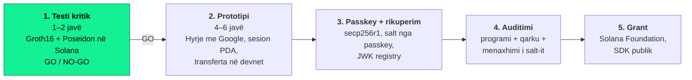

# solanaauth

**Portofol Solana pa frazë sekrete: hyrje me Google/Apple, e verifikuar on-chain me Groth16.**

Çdo aplikacion në Solana të mund t'u japë përdoruesve një portofol vetë-kujdestar me "Hyr me Google/Apple", pa frazë sekrete dhe pa një kompani që mban apo bashkë-mban çelësin. Prova verifikohet nga vetë Solana; passkey-ja është faktori i dytë dhe rruga e rikuperimit. Kodi dhe matjet janë publike që nga dita e parë.

[](https://github.com/intopic/solanaauth/actions/workflows/ci.yml)
· Licenca: [Apache-2.0](LICENSE)

## Harta e projektit



Faza 1 (tani) është vetëm një test matjesh: a pranon Solana provën zkLogin dhe sa compute units (CU) kushton. Rezultati vendos nëse vazhdojnë fazat e tjera.

**Brief-i i plotë për developer-in:** [`docs/HAPI-1-BRIEF.md`](docs/HAPI-1-BRIEF.md)

## Rezultatet e fundit (nga GitHub Actions)

Tabela përditësohet automatikisht nga CI në çdo push në `main`. Pranojmë vetëm numrat e prodhuar këtu, jo matje nga kompjuteri personal.

<!-- CU-RESULTS:START -->
## Matjet e CU — zklogin-verifier

| Matja | CU | Shënim |
|---|---:|---|
| `verify_proof` | — | Groth16 me groth16-solana |
| `poseidon (secili hap)` | — | sol_poseidon |
| `modulus RSA hash` | — | kandidat për JWK registry |
| `verify_full` | — | Poseidon + Groth16, kriteri GO/NO-GO |

**Vendimi:** PA MATJE
<!-- CU-RESULTS:END -->

| Kostoja totale e `verify_full` | Vendimi |
|---|---|
| Deri ~400,000 CU | **GO** |
| ~400,000 – 1,000,000 CU | **GO me kujdes** (regjistrimi i sesionit në tx më vete) |
| 1,000,000 – 1,400,000 CU | **Rishikim** (modulus i para-llogaritur në JWK registry) |
| Mbi 1,400,000 CU ose prova s'pranohet | **NO-GO** për qasjen direkte |

## Struktura

```text
solanaauth/
├── programs/zklogin-verifier/    # programi Solana (Anchor ose native) — ndërtohet me cargo build-sbf
├── reference/                    # verifikimi off-chain me sui-crypto (e vërteta referencë)
├── fixtures/                     # test vectors: prova, input-et, verifying key
├── bench/                        # matjet e CU (Mollusk / LiteSVM) → results/
├── scripts/                      # update_readme.py, devnet.sh, konvertimi i key-t
├── results/                      # cu-report.json + cu-report.md (i përditësuar nga CI)
├── docs/HAPI-1-BRIEF.md          # brief-i i developer-it
└── .github/workflows/ci.yml
```

## Si riprodhohet

```bash
# Rust stable, Solana CLI (Anza) 4.x, Node.js 20+
sh -c "$(curl -sSfL https://release.anza.xyz/stable/install)"

cargo test -p reference -- --nocapture   # verifikimi referencë off-chain
cargo build-sbf --manifest-path programs/zklogin-verifier/Cargo.toml
cargo test -p bench -- --nocapture       # matjet e CU → results/
```

## CI

Workflow-i [`.github/workflows/ci.yml`](.github/workflows/ci.yml):

1. **build** — `cargo build-sbf` për programin (anashkalohet derisa të shtohet `programs/zklogin-verifier/Cargo.toml`).
2. **reference** — `cargo test -p reference`.
3. **bench** — `cargo test -p bench`, shkruan `results/cu-report.{json,md}`, i shfaq në Job Summary dhe i ngarkon si artifact.
4. **publish** — në `main` bën commit të `results/` dhe të tabelës më sipër; në tag `v*` krijon një GitHub Release me raportin.
5. **devnet** (manuale) — *Actions → ci → Run workflow → devnet*: deploy në devnet me secret-in `DEVNET_DEPLOYER_KEYPAIR`.

**Siguria:** asnjë çelës mainnet në repo apo në Secrets. I vetmi secret është `DEVNET_DEPLOYER_KEYPAIR`, një çelës devnet pa vlerë reale.
